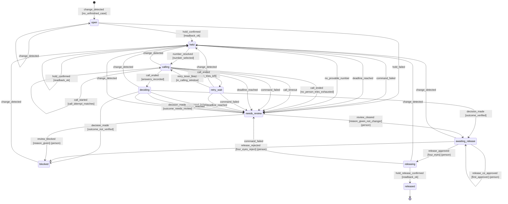

# Case state machine

Generated by `scripts/db/render_state_machine.py` from `app.case_transitions`. Do not edit by hand.

Ten states. `released` is the only finished state. Every failure path ends in a state where the
hold stays on. Moves marked **person** need a signed-in user; everything else is the system.

| From | Event | Who | Guard | To | Why |
|---|---|---|---|---|---|
| (new) | `change_detected` | system | `no_unfinished_case` | open | A bank change for a vendor with no unfinished case opens a case |
| open | `change_detected` | system | `always` | open | Another change before the hold is confirmed: same case, version + 1 |
| open | `hold_confirmed` | system | `readback_ok` | held | Read-back shows the hold |
| open | `hold_failed` | system | `always` | needs_review | Retries used up; the hold was never confirmed |
| held | `change_detected` | system | `always` | held | Another change: version + 1 |
| held | `command_failed` | system | `always` | needs_review | A command kept failing; hold stays on |
| held | `deadline_reached` | system | `always` | needs_review | Deadline passed; hold stays on |
| held | `hold_confirmed` | system | `readback_ok` | held | Hold confirmed again after another change (version + 1) |
| held | `no_provable_number` | system | `always` | needs_review | No number with two independent sources that predate the request |
| held | `number_resolved` | system | `number_selected` | calling | The Trust Ledger rule passed |
| calling | `call_ended` | system | `answers_recorded` | deciding | Answers recorded |
| calling | `call_ended` | system | `no_person_tries_exhausted` | needs_review | No person reached; no tries left |
| calling | `call_ended` | system | `no_person_tries_left` | retry_wait | No person reached; tries left |
| calling | `call_started` | system | `call_attempt_matches` | calling | The voice service accepted the call; pins the current call |
| calling | `call_timeout` | system | `always` | needs_review | The call never reported back |
| calling | `change_detected` | system | `always` | held | Another change: back to held, version + 1 |
| calling | `command_failed` | system | `always` | needs_review | A command kept failing; hold stays on |
| calling | `deadline_reached` | system | `always` | needs_review | Deadline passed; hold stays on |
| retry_wait | `change_detected` | system | `always` | held | Another change: back to held, version + 1 |
| retry_wait | `command_failed` | system | `always` | needs_review | A command kept failing; hold stays on |
| retry_wait | `deadline_reached` | system | `always` | needs_review | Deadline passed; hold stays on |
| retry_wait | `retry_timer_fired` | system | `in_calling_window` | calling | Inside the calling window |
| deciding | `change_detected` | system | `always` | held | Another change: back to held, version + 1, decision void |
| deciding | `command_failed` | system | `always` | needs_review | A command kept failing; hold stays on |
| deciding | `deadline_reached` | system | `always` | needs_review | Deadline passed; hold stays on |
| deciding | `decision_made` | system | `outcome_needs_review` | needs_review | Needs review |
| deciding | `decision_made` | system | `outcome_not_verified` | blocked | Not verified: the hold stays and the controller is alerted |
| deciding | `decision_made` | system | `outcome_verified` | awaiting_release | Verified |
| awaiting_release | `change_detected` | system | `always` | held | Another change: back to held, version + 1, decision void |
| awaiting_release | `release_approved` | **person** | `four_eyes` | releasing | Approver role; not the changer nor the reviewer; version matches; second approver when the changer is unknown |
| awaiting_release | `release_co_approved` | **person** | `first_approver` | awaiting_release | Unknown changer: first of two approvers (ADR-10) |
| awaiting_release | `release_rejected` | **person** | `four_eyes_reject` | blocked | Approver rejects with a written reason |
| needs_review | `change_detected` | system | `always` | held | Another change: back to held, version + 1 |
| needs_review | `review_blocked` | **person** | `reason_given` | blocked | Written reason |
| needs_review | `review_cleared` | **person** | `reason_given_not_changer` | awaiting_release | Not the changer; written reason |
| blocked | `change_detected` | system | `always` | held | Another change: back to held, version + 1, decision void |
| releasing | `change_detected` | system | `always` | held | Another change during release: back to held, version + 1 |
| releasing | `command_failed` | system | `always` | needs_review | Release kept failing; hold stays on |
| releasing | `hold_release_confirmed` | system | `readback_ok` | released | Read-back shows no hold |
